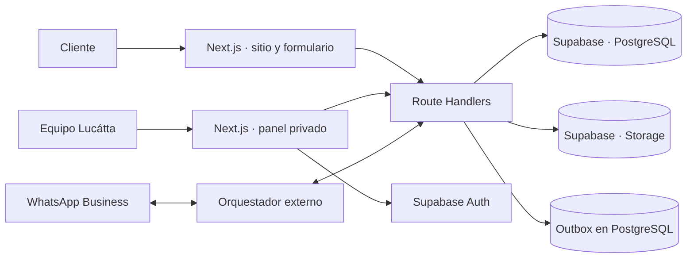

<div align="center">


# Lucátta · experiencia digital para pedidos personalizados

**De una idea para celebrar a una solicitud estructurada, una cotización humana y una operación trazable.**

[Ver sitio en vivo](https://lucatta-web.vercel.app) · [Crear un pedido](https://lucatta-web.vercel.app/pedido) · [Explorar el código](#arquitectura)

</div>

> **In English:** A full-stack, production-oriented ordering platform for a custom bakery. It combines a guided customer journey, an owner dashboard, Supabase-backed operations, and API endpoints for WhatsApp automation. Pricing and payment verification remain human decisions by design.

## El problema

Un pedido artesanal no encaja bien en un carrito convencional: la fecha, las porciones, los sabores, el diseño, la entrega y la disponibilidad cambian cada cotización. Coordinar todo por mensajes sueltos dificulta recuperar el contexto, dar seguimiento al anticipo y mantener una agenda confiable.

Lucátta convierte esa conversación en un flujo claro: el cliente comparte lo necesario para cotizar; el negocio revisa, responde y administra el pedido desde un solo lugar. El formulario **no cobra ni reserva automáticamente** una fecha.

## Qué construí

| Área | Capacidad |
| --- | --- |
| Experiencia pública | Sitio responsivo con galería, información del local, página de eventos, condiciones de pedidos y aviso de privacidad. |
| Solicitud guiada | Formulario por pasos para pasteles, postres y eventos; opciones de catálogo, fecha, modalidad de entrega e imagen de referencia. |
| Operación | Panel privado para pedidos, agenda, clientes, catálogo, cierres y configuración del negocio. |
| Cotización y anticipo | Registro de cotización, reserva temporal, recepción de comprobantes y aprobación o rechazo por una persona. |
| Mensajería | API para recibir eventos de WhatsApp, conservar el contexto de la conversación y preparar respuestas en una cola de salida. |
| Seguimiento | Recordatorios y tareas programadas para anticipos, borradores abandonados y entregas próximas. |

### Decisiones de ingeniería

- **El precio lo confirma una persona.** La interfaz reúne requisitos sin presentar una cifra falsa para un producto hecho a medida.
- **Las reglas viven también en el servidor.** La API comprueba datos, fechas, cierres y disponibilidad antes de registrar solicitudes.
- **Los datos sensibles tienen acceso acotado.** El panel valida al propietario mediante Supabase Auth; las credenciales de servicio quedan en el servidor y los comprobantes se guardan en almacenamiento privado.
- **La mensajería tolera reintentos.** Los eventos entrantes se identifican por el ID del proveedor; la cola usa claves de deduplicación y una función SQL para reclamar lotes de forma atómica.
- **El estado del pedido es explícito.** Solicitud, revisión, cotización, anticipo, producción y entrega se modelan como etapas operativas que se pueden auditar.

## Arquitectura



El repositorio contiene la aplicación, los endpoints de integración y las migraciones SQL. El transporte hacia WhatsApp Business y la ejecución periódica requieren configurar un orquestador externo; esos servicios no se inician con `npm run dev`.

### Stack

**Next.js 16 · React 19 · TypeScript · Tailwind CSS 4 · Supabase (PostgreSQL, Auth y Storage) · Vercel**

La interfaz usa componentes reutilizables y `lucide-react`. Las APIs se implementan con Route Handlers de Next.js; la persistencia se consulta desde el servidor mediante la API REST de Supabase.

## Ejecutar localmente

**Requisitos:** Node.js 22, npm y un proyecto de Supabase para probar las funciones de pedidos y administración.

```bash
git clone https://github.com/fabrizzio2901/lucatta-web.git
cd lucatta-web
npm ci
cp .env.example .env.local
npm run dev
```

En PowerShell, usa `Copy-Item .env.example .env.local` en lugar de `cp`. Abre [http://localhost:3000](http://localhost:3000).

Antes de probar los flujos con datos:

1. Ejecuta los archivos de [`supabase/migrations`](./supabase/migrations) **en orden de nombre** en el SQL Editor de tu proyecto.
2. Si quieres opciones de catálogo de ejemplo, ejecuta [`supabase/seed.sql`](./supabase/seed.sql). El panel permite modificarlas después.
3. Configura los valores de `.env.local` y habilita el acceso por código de correo en Supabase Auth. El correo indicado en `LUCATTA_OWNER_EMAIL` debe existir como usuario autorizado.
4. Para la mensajería, conecta tu orquestador y WhatsApp Business a los endpoints de integración.

| Variable | Uso |
| --- | --- |
| `NEXT_PUBLIC_SITE_URL` | URL pública para enlaces enviados al cliente. |
| `NEXT_PUBLIC_SUPABASE_URL` | URL del proyecto Supabase. |
| `NEXT_PUBLIC_SUPABASE_ANON_KEY` | Clave pública necesaria para el flujo de autenticación. |
| `SUPABASE_URL` | URL de Supabase usada por las rutas del servidor. |
| `SUPABASE_SERVICE_ROLE_KEY` | Acceso del servidor a datos y archivos; nunca debe exponerse al navegador. |
| `LUCATTA_OWNER_EMAIL` | Único correo autorizado para el panel. |
| `LUCATTA_AUTOMATION_KEY` | Secreto compartido para los endpoints internos y de integración. |

La plantilla está en [`.env.example`](./.env.example). **No publiques `.env.local` ni claves reales.**

## Recorridos para explorar

1. **Cliente:** abre [`/pedido`](https://lucatta-web.vercel.app/pedido), elige el tipo de producto y envía una solicitud con detalles y fecha. El sistema devuelve un folio para continuar la conversación.
2. **Propietario:** entra a `/administracion` con un código por correo, revisa pedidos y agenda, ajusta el catálogo o registra un cierre.
3. **Anticipo:** registra una cotización y revisa un comprobante recibido por WhatsApp antes de confirmar el pedido.
4. **Automatización:** procesa eventos entrantes, genera respuestas en la outbox y ejecuta recordatorios mediante un servicio externo autenticado.

Para entender cada parte, empieza por [`app/pedido`](./app/pedido), [`app/administracion`](./app/administracion), [`app/api`](./app/api) y [`supabase`](./supabase).

## Calidad y alcance

```bash
npm run lint
npm run build
```

El despliegue está preparado para Vercel mediante [`vercel.json`](./vercel.json). La experiencia pública puede explorarse sin credenciales; las operaciones con pedidos, el panel y WhatsApp necesitan un Supabase configurado y servicios externos conectados. Los pagos se verifican manualmente: el proyecto no integra una pasarela de cobro.

---

<div align="center">

**Diseñado y desarrollado para Lucátta, una pastelería artesanal en Puebla.**

[Sitio](https://lucatta-web.vercel.app) · [GitHub de Fabrizzio](https://github.com/fabrizzio2901)

</div>
